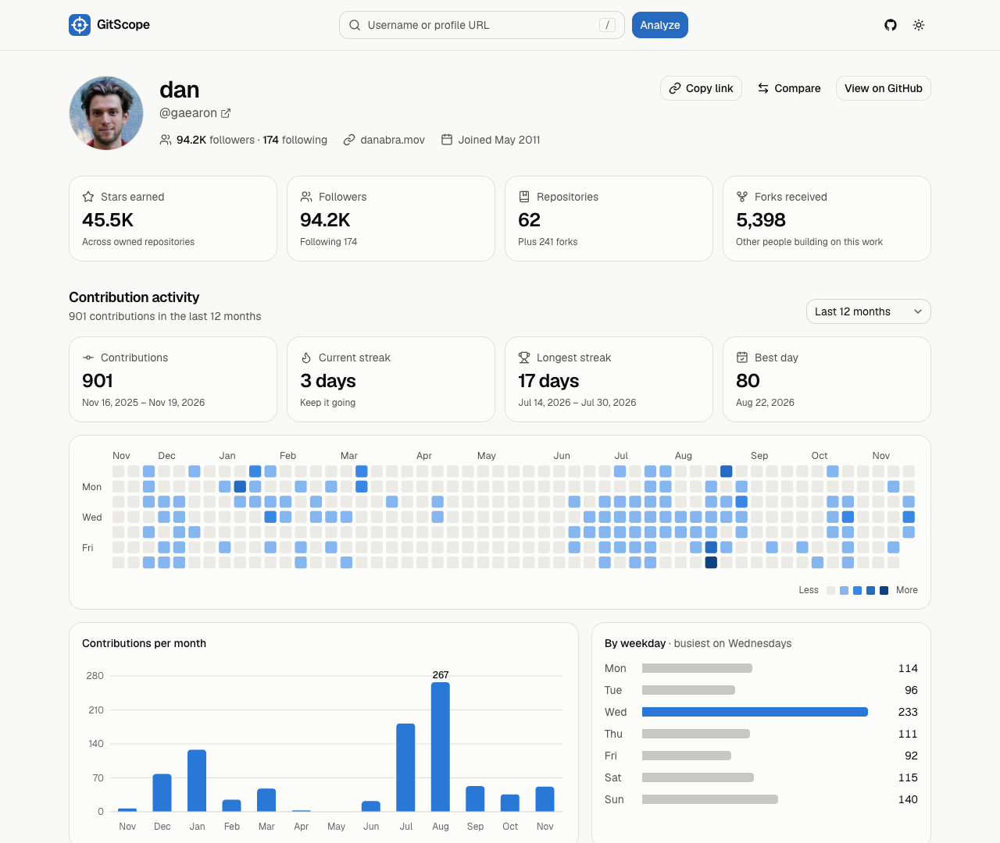
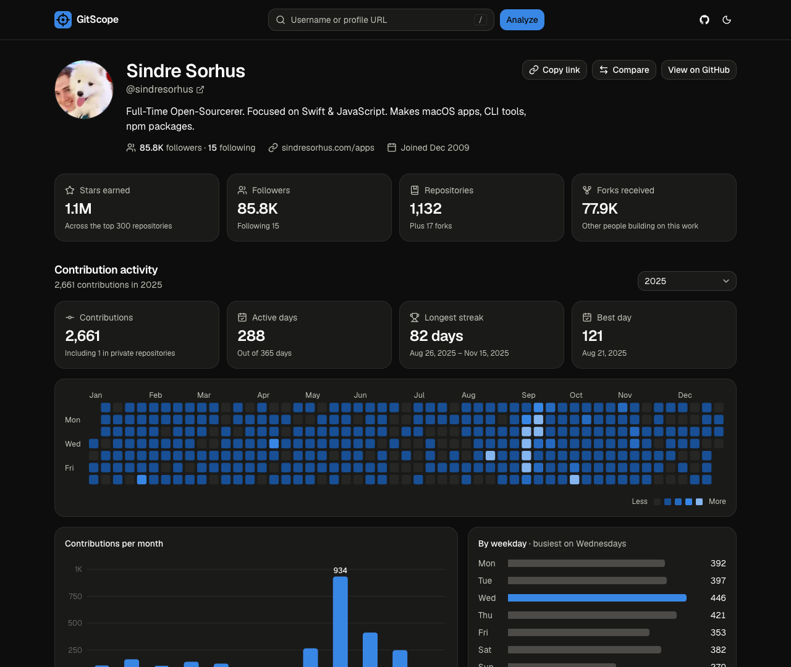
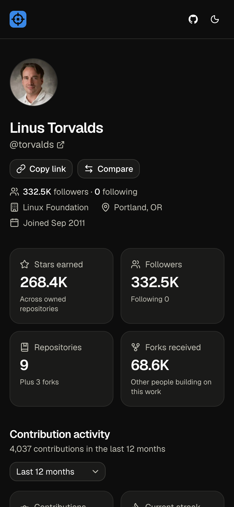
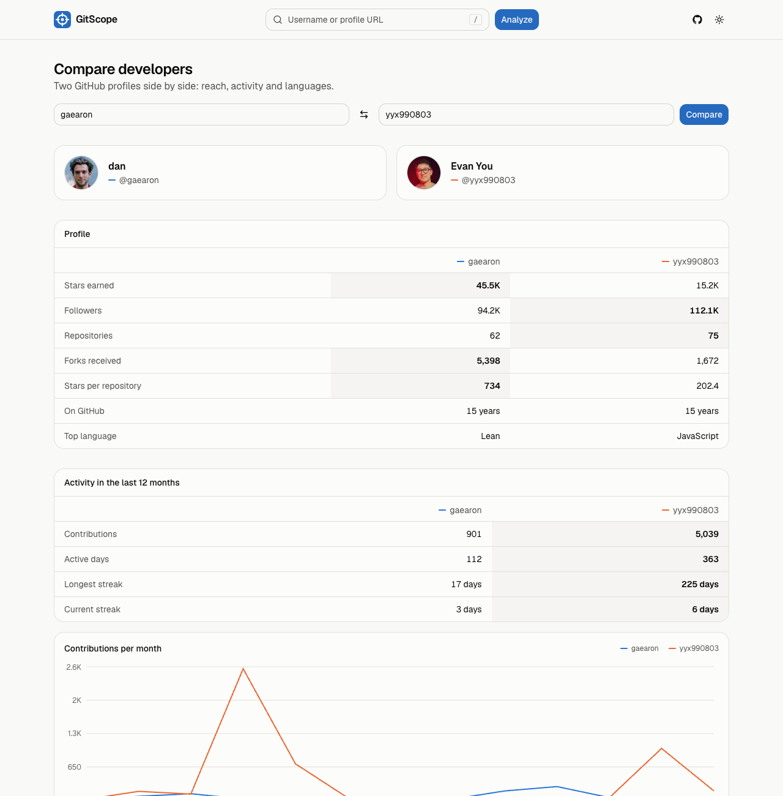
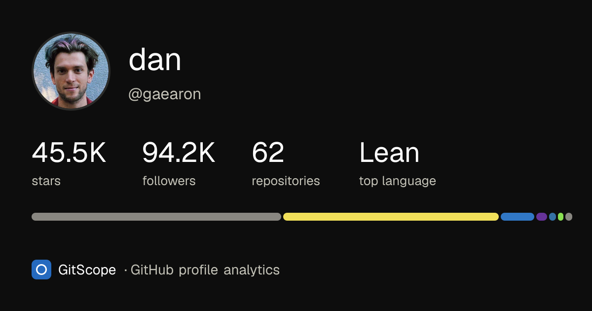
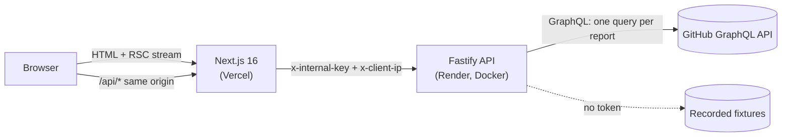

# GitScope

**Shareable analytics for any public GitHub profile** — contribution heatmap for any year, languages weighted by code,
streaks, insights, top repositories and a side-by-side comparison of two developers. Every profile has its own link
with a rich preview card.

[](https://github.com/VolodymyrZiabkin/gitscope/actions/workflows/ci.yml)



<table>
  <tr>
    <td width="68%"></td>
    <td></td>
  </tr>
  <tr>
    <td></td>
    <td></td>
  </tr>
</table>

## Features

- **Profile dashboard** — key numbers, a GitHub-style contribution heatmap with a year switch, contributions per month,
  activity by weekday, current and longest streaks, best day.
- **Languages that matter** — weighted by bytes of code across owned repositories, not by repository count.
- **Repositories** — search, language filter and sorting; the state lives in the URL, so a filtered view is a link.
- **Compare** two developers: reach, activity, a two-series monthly chart and languages side by side.
- **Made to be shared** — server-rendered pages, per-profile metadata and generated Open Graph images.
- **Polished states** — skeletons that match the layout, "user not found", "rate limited, retry in N minutes",
  empty profiles, dark mode, keyboard navigation, 375px screens.

## Architecture



A pnpm monorepo with three packages:

| Package | Role |
|---|---|
| `packages/shared` | The API contract: Zod schemas and the types inferred from them |
| `apps/api` | Fastify BFF in front of GitHub: caching, rate limiting, analytics, OpenAPI docs |
| `apps/web` | Next.js App Router frontend, structured with Feature-Sliced Design |

### Key decisions

- **A separate API instead of Next.js route handlers.** A long-lived process keeps an in-memory LRU cache with request
  coalescing (ten concurrent requests for one user make one GitHub call) and a rate limiter — without Redis.
  Serverless functions would lose that memory between invocations. The GitHub token never leaves the API.
- **GraphQL, not REST.** A profile with 100 repositories and their language breakdowns is one request instead of
  a hundred; the contribution calendar exists only in GraphQL.
- **Contract first.** The same Zod schemas validate the API's own responses (Fastify serializer), generate the
  OpenAPI document (`/docs`) and parse responses in the web app. GitHub responses are parsed as well — nothing
  upstream is trusted blindly.
- **Errors as data.** The API answers with RFC 9457 `problem+json` and a machine-readable `code`; the web app turns
  expected failures (`USER_NOT_FOUND`, `RATE_LIMITED`) into UI states, and `error.tsx` is reserved for bugs.
- **Rate limiting by the real visitor.** Server-side requests all come from Vercel's IPs, so the web app forwards the
  visitor's IP — trusted by the API only together with a shared key (timing-safe comparison).
- **Server Components by default.** TanStack Query is used only where the client owns the data: the server prefetches
  the contribution calendar into a query cache and streams it in behind a Suspense boundary; switching years happens
  on the client and keeps the previous render at reduced opacity instead of flashing a skeleton.
- **URL as state without server round trips.** Filters and the selected year are written with
  `history.replaceState`: links stay shareable, and Next.js does not re-render the server page.
- **Accessible charts.** Colours come from a palette validated for colour vision deficiency in light and dark mode.
  The heatmap is a single SVG with one tab stop, arrow-key navigation and a live region; charts have table
  alternatives; the weekday chart uses emphasis rather than a rainbow.
- **Fixture mode.** Without a token the API serves recorded GitHub data, so the app runs locally without any keys and
  CI and end-to-end tests are deterministic.
- **Deliberate trade-off:** the dashboard shows an instant skeleton while a free-tier API wakes up. Streaming starts
  before the user is known, so an unknown user is served with status 200 and `noindex` rather than a hard 404.

## Tech stack

| Area | Choice |
|---|---|
| Web | Next.js 16 (App Router, RSC, streaming, React Compiler), React 19, TanStack Query |
| UI | Tailwind CSS v4, shadcn/ui on Base UI, Recharts, a custom SVG heatmap |
| API | Fastify 5, `fastify-type-provider-zod`, `@fastify/rate-limit`, `@fastify/helmet`, `@fastify/swagger`, pino, `lru-cache` |
| Contract | Zod 4 in a shared workspace package |
| Quality | TypeScript strict (`noUncheckedIndexedAccess`), ESLint (type-checked), Steiger (FSD), Prettier |
| Tests | Vitest, Testing Library, MSW, Playwright |
| Delivery | GitHub Actions, Docker, Vercel + Render |

## Getting started

Requirements: Node.js 24 and pnpm 10 (`corepack enable`).

```bash
git clone https://github.com/VolodymyrZiabkin/gitscope.git && cd gitscope
pnpm install
pnpm dev
```

The web app runs on http://localhost:3000 and the API on http://localhost:4000 (Swagger UI at `/docs`).
**No keys are needed:** without a token the API serves recorded data for
[gaearon](http://localhost:3000/u/gaearon), [sindresorhus](http://localhost:3000/u/sindresorhus),
[torvalds](http://localhost:3000/u/torvalds) and [yyx990803](http://localhost:3000/u/yyx990803).

For live data, create a [fine-grained personal access token](https://github.com/settings/personal-access-tokens/new)
(public repositories, read-only, no extra permissions) and put it into `apps/api/.env`:

```bash
cp apps/api/.env.example apps/api/.env   # then set GITHUB_TOKEN=...
```

| Command | What it does |
|---|---|
| `pnpm dev` | API and web app in watch mode |
| `pnpm lint` / `pnpm typecheck` / `pnpm format:check` | Static checks for every package |
| `pnpm test` | Unit and component tests |
| `pnpm e2e` | Playwright against a production build in fixture mode |
| `pnpm build` | Production builds |
| `pnpm --filter @gitscope/api fixtures:record <logins>` | Record fixtures (needs a token) |

## Testing

- **API (81 tests):** pure analytics (streaks across year boundaries and leap days, time-zone independence),
  the GraphQL client (pagination, quota errors, retries, schema mismatches), cache coalescing and routes through
  `app.inject` — caching, ETags, validation, rate limiting by forwarded IP, problem details.
- **Web (54 tests):** formatting and URL-state helpers, the calendar grid, the browser API client against MSW, and
  client widgets — repository filters synced to the URL, switching years with hydrated data, retryable errors,
  the search form.
- **Shared (15 tests)** and **end-to-end (10 Playwright tests):** search → dashboard, year switch restored from a link,
  keyboard heatmap, filters, not-found, comparison, Open Graph image, proxy allow-list, no horizontal scroll on a phone.

## Deployment

The API and the web app are deployed separately, both on free tiers.

1. **API → Render.** Create a Blueprint from `render.yaml` (Docker, health check on `/health`) and set `GITHUB_TOKEN`
   and `INTERNAL_API_KEY` (`openssl rand -hex 32`). Free instances sleep when idle and need up to a minute to wake;
   the home page pings the API on load to hide most of that.
2. **Web → Vercel.** Import the repository with `apps/web` as the root directory and set `API_URL` (the Render URL)
   and the same `INTERNAL_API_KEY`.

## Limitations

- Only public data. Private contributions appear only as a count, and only if the user has enabled that on GitHub.
- Repositories are analysed up to the 300 most starred ones; for prolific users the totals cover those repositories.
- Organizations are not supported — GitScope analyses personal profiles.

## Project structure

```
apps/api/src
  modules/github      GraphQL and fixture clients behind one interface
  modules/analytics   pure functions: languages, streaks, activity, insights
  modules/users       routes → service (cache) → mapper (GitHub → contract)
  plugins             problem+json errors, rate limit, Swagger
apps/web
  app                 Next.js routing only — re-exports pages
  src                 app → pages → widgets → features → entities → shared (Feature-Sliced Design)
packages/shared/src   Zod contract
e2e                   Playwright
```
